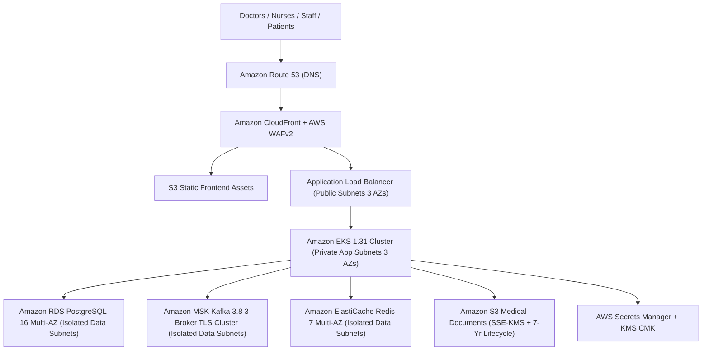

# HOSPITAL OPERATING SOFTWARE (HOS) — AWS CLOUD ARCHITECTURE (`AWS_ARCHITECTURE.md`)

## 1. Multi-AZ Healthcare Cloud Topology (`ap-south-1` / Mumbai)
The production AWS architecture is designed for a 500+ bed multispecialty hospital with zero single points of failure and strict compliance with **Rule 9** (PostgreSQL, Redis, Kafka, and internal microservice ports are never exposed to the public internet):

---

## 2. Network Isolation & Security Zones
1. **Public Subnets (`10.40.1.0/24` – `10.40.3.0/24`):** Host only the AWS WAF-protected Application Load Balancer (ALB) and NAT Gateways.
2. **Private Application Subnets (`10.40.11.0/24` – `10.40.13.0/24`):** Host Amazon EKS worker nodes running the 6 NestJS microservice runtimes (`api-gateway`, `identity-service`, `hospital-core-service`, `clinical-emr-service`, `diagnostics-pharmacy-service`, `operations-billing-service`).
3. **Isolated Data Subnets (`10.40.21.0/24` – `10.40.23.0/24`):** Zero route to Internet Gateway or NAT Gateway. Host Amazon RDS PostgreSQL 16 Multi-AZ (`publicly_accessible = false`), Amazon MSK Kafka 3.8, and Amazon ElastiCache Redis 7.

---

## 3. Financial Cost Estimation & Approval Gate (Section 5 Compliance)
Before running `terraform apply` against a live AWS account, review the estimated monthly run-rate for the 500+ bed production topology vs. a right-sized staging/dev topology:

| AWS Resource | Production Spec (3-AZ HA) | Est. Prod Monthly Cost (USD) | Dev/Staging Spec | Est. Dev Monthly Cost (USD) |
|---|---|---|---|---|
| **Amazon EKS Control Plane + Nodes** | 1 Control Plane + 3x `m6i.xlarge` | \$495 | 1 Control Plane + 2x `t3.large` | \$190 |
| **Amazon RDS PostgreSQL 16** | Multi-AZ `db.r6g.xlarge` (200 GB gp3) | \$710 | Single-AZ `db.t4g.medium` | \$68 |
| **Amazon MSK Kafka 3.8** | 3x `kafka.m5.large` (500 GB EBS) | \$480 | 3x `kafka.t3.small` | \$115 |
| **Amazon ElastiCache Redis 7** | 3x `cache.r6g.large` Multi-AZ | \$390 | 1x `cache.t4g.micro` | \$14 |
| **ALB + WAFv2 + CloudFront + S3 + KMS** | Regional WAF + ALB + 500 GB S3 KMS | \$115 | ALB + 50 GB S3 KMS | \$35 |
| **Total Estimated Monthly Cost** | **Production 500+ Bed HA** | **~\$2,190 / month** | **Staging / UAT** | **~\$422 / month** |

> **Cost Control Policy:** No billable AWS resources are provisioned automatically without explicit user approval and AWS IAM Identity Center / SSO credentials.

