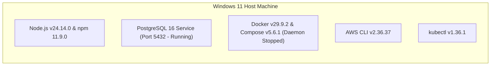

# BLOCK 00 — Current Architecture (`CURRENT_ARCHITECTURE.md`)

## 1. Baseline State (Pre-Implementation)

At the start of Block 00, the repository `c:\Users\Pranjal\OneDrive\Desktop\Emerald Windows\My_Projects\HOS - Antigravity` contained **no application source code, database schemas, or infrastructure manifests**.

### Current Baseline Artefacts Created in Block 00
```text
HOS - Antigravity/
├── .git/                         # Initialized Git repository
├── .gitignore                    # Strict secret, build, and state exclusions
├── .env.example                  # Sanitized environment variable template
├── REPOSITORY_AUDIT.md           # Complete audit of repo & host environment
├── CURRENT_ARCHITECTURE.md       # Baseline architecture snapshot
├── IMPLEMENTATION_GAP_ANALYSIS.md# Gap analysis against 500+ bed HOS requirements
└── BLOCK_STATUS.md               # Central block-by-block tracking ledger
```

## 2. Host Runtime Topology Available



## 3. Transition to Target Architecture (Block 01+)

Because this is a clean greenfield workspace, there is no legacy technical debt or conflicting code. In **Block 01**, we will define the complete target microservice architecture covering all 38 hospital functional domains organized into cohesive, deployable domain microservices with strict database schema ownership, REST + gRPC synchronous APIs, and Apache Kafka + Transactional Outbox asynchronous event streaming.

