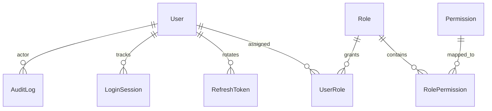
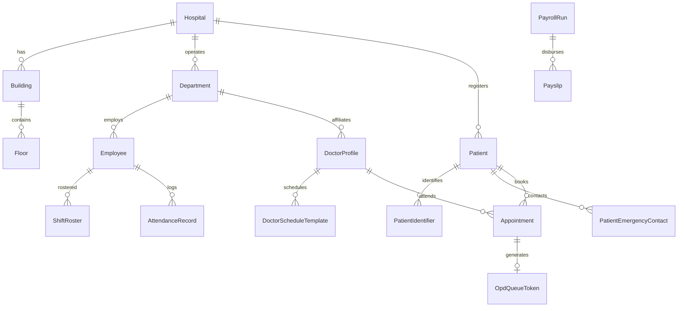
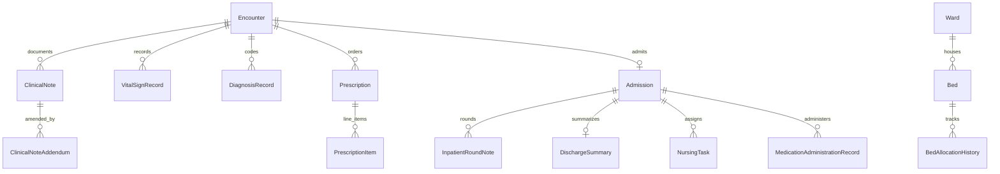
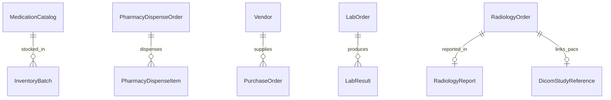
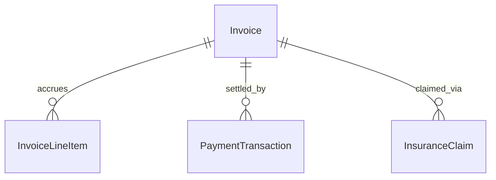

# BLOCK 02 — Database Architecture (`DATABASE_ARCHITECTURE.md`)

## 1. Multi-Schema Ownership & Strict Isolation Matrix

In accordance with **Non-Negotiable Engineering Rules 15 & 16** (*"Do not allow one microservice to access another microservice's database directly"* and *"Every microservice must own its data and migrations"*), the PostgreSQL 16 database (`hos_db`) is partitioned into **5 isolated schemas**, each owned by a dedicated PostgreSQL role and managed by its own independent Prisma schema and generated client:

| Microservice Runtime | PostgreSQL Schema | Dedicated DB Role | Generated Prisma Client Path | Core Domain Entities Owned |
|---|---|---|---|---|
| `identity-service` | `identity` | `hos_identity_user` | `node_modules/.prisma/identity-client` | `User`, `Role`, `Permission`, `RolePermission`, `UserRole`, `RefreshToken`, `PasswordResetToken`, `LoginSession`, `AuditLog`, `OutboxEvent`, `ProcessedEvent` |
| `hospital-core-service` | `hospital_core` | `hos_core_user` | `node_modules/.prisma/hospital-core-client` | `Hospital`, `Building`, `Floor`, `Department`, `Employee`, `ShiftRoster`, `DoctorProfile`, `DoctorScheduleTemplate`, `Patient`, `PatientIdentifier`, `PatientEmergencyContact`, `Appointment`, `OpdQueueToken`, `AttendanceRecord`, `LeaveRequest`, `PayrollRun`, `Payslip`, `OutboxEvent`, `ProcessedEvent` |
| `clinical-emr-service` | `clinical` | `hos_clinical_user` | `node_modules/.prisma/clinical-client` | `Encounter`, `ClinicalNote`, `ClinicalNoteAddendum`, `VitalSignRecord`, `DiagnosisRecord`, `PatientAllergy`, `Prescription`, `PrescriptionItem`, `Ward`, `Bed`, `Admission`, `BedAllocationHistory`, `InpatientRoundNote`, `DischargeSummary`, `NursingTask`, `MedicationAdministrationRecord`, `CompounderTask`, `EmergencyCase`, `SurgerySchedule`, `IcuFlowsheetRecord`, `OutboxEvent`, `ProcessedEvent` |
| `diagnostics-pharmacy-service` | `diagnostics_pharmacy` | `hos_diag_user` | `node_modules/.prisma/diagnostics-pharmacy-client` | `MedicationCatalog`, `InventoryBatch`, `PharmacyDispenseOrder`, `PharmacyDispenseItem`, `Vendor`, `PurchaseOrder`, `LabTestCatalog`, `LabOrder`, `LabResult`, `RadiologyOrder`, `RadiologyReport`, `DicomStudyReference`, `BloodUnit`, `OutboxEvent`, `ProcessedEvent` |
| `operations-billing-service` | `operations_billing` | `hos_ops_user` | `node_modules/.prisma/operations-billing-client` | `Invoice`, `InvoiceLineItem`, `PaymentTransaction`, `InsuranceClaim`, `Ambulance`, `MedicalAsset`, `HousekeepingTask`, `NotificationRecord`, `DocumentRecord`, `DailyHospitalMetricSnapshot`, `OutboxEvent`, `ProcessedEvent` |

---

## 2. Entity-Relationship (ER) Diagrams by Schema

### 2.1 `identity` Schema

### 2.2 `hospital_core` Schema

### 2.3 `clinical` Schema

### 2.4 `diagnostics_pharmacy` Schema

### 2.5 `operations_billing` Schema

---

## 3. Clinical & Financial Integrity Constraints

1. **Double-Booking Prevention:** `Appointment` enforces `@@unique([doctorId, scheduledStart])` and `OpdQueueToken` enforces `@@unique([doctorId, queueDate, tokenNumber])`.
2. **Idempotent Financial Payments:** `PaymentTransaction` enforces `@unique` on `idempotencyKey` and `receiptNumber`, and stores all monetary values as integer `BigInt` minor units (`paise`/`cents`) to eliminate IEEE-754 floating-point rounding bugs.
3. **Immutable Signed Clinical Records:** `ClinicalNote` includes `isImmutable`, `contentHash` (SHA-256), and `signedAt`. Database trigger `clinical.prevent_signed_clinical_note_mutation()` blocks any `UPDATE` or `DELETE` once `isImmutable = true`. Amendments must be inserted into `ClinicalNoteAddendum`.
4. **Tamper-Evident Audit Chain:** `identity.AuditLog` chains each entry via `previousHash` and `integrityHash` (SHA-256) and is protected by `identity.prevent_audit_log_mutation()`.

---

## 4. Soft-Delete & Data Retention Rules

- **Soft Delete (`deletedAt`):** Applied to `User` and `Patient` records so historical references remain intact. Clinical notes, prescriptions, audit logs, invoices, and payments **never** support deletion (neither hard nor soft); financial reversals use explicit `RefundRecord` / credit line items.
- **Data Retention Policy:**
  - `ClinicalNote`, `Prescription`, `DischargeSummary`, `LabResult`, `RadiologyReport`, `DocumentRecord`: Minimum **7 years** (or pediatric maturity + 7 years per medical record retention standards).
  - `AuditLog`: **10 years** (hot in PostgreSQL for 1 year, archived to AWS S3 Object Lock Glacier Deep Archive thereafter).
  - `OutboxEvent` (`PUBLISHED`) & `ProcessedEvent`: Retained for **30 days** for replay/debugging, then pruned via scheduled BullMQ maintenance job.

