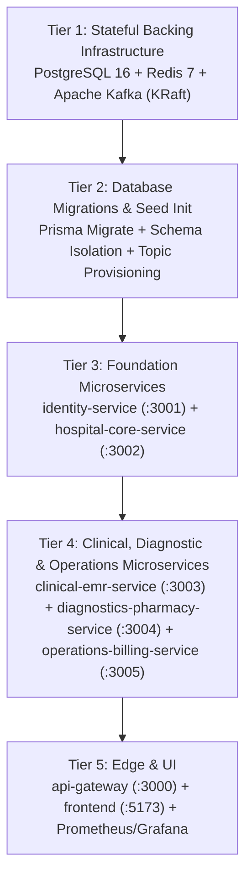

# BLOCK 01 — Service Dependency Map (`SERVICE_DEPENDENCY_MAP.md`)

## 1. Synchronous vs. Asynchronous Dependency Matrix

To prevent distributed monoliths and cascading failures, synchronous calls are strictly minimized to edge routing and immediate identity/reference verification. All cross-domain workflows use **Apache Kafka with Transactional Outbox**.

| Source Service | Target Service | Protocol | Purpose | Fallback if Target Unavailable |
|---|---|---|---|---|
| `frontend` | `api-gateway` | HTTPS REST / WSS | All user portal operations & live UI updates | React Query retry + offline banner |
| `api-gateway` | `identity-service` | REST / gRPC | Login, token refresh, RBAC policy cache | Local JWT signature verification + cached permissions in Redis |
| `api-gateway` | `hospital-core-service` | REST | Patient, Doctor, Appointment, OPD, HR APIs | Circuit breaker (`503 Service Unavailable`) |
| `api-gateway` | `clinical-emr-service` | REST | Encounter, EMR, Prescription, IPD, Bed, Nursing, ER, OT, ICU APIs | Circuit breaker (`503 Service Unavailable`) |
| `api-gateway` | `diagnostics-pharmacy-service` | REST | Lab, Radiology, PACS, Pharmacy, Inventory, Procurement, Blood Bank APIs | Circuit breaker (`503 Service Unavailable`) |
| `api-gateway` | `operations-billing-service` | REST | Billing, Payment, Insurance, S3 Documents, Notifications, Analytics APIs | Circuit breaker (`503 Service Unavailable`) |
| `clinical-emr-service` | `hospital-core-service` | gRPC (`:50052`) | Verify active `patientId` & `doctorId` on new Encounter | Cached patient/doctor summary in Redis |
| `hospital-core-service` | `clinical-emr-service`, `operations-billing-service` | **Kafka (Async)** | `hospital.patient.registered`, `hospital.appointment.created` | Persisted in PostgreSQL `OutboxEvent` until Kafka recovers |
| `clinical-emr-service` | `diagnostics-pharmacy-service`, `operations-billing-service` | **Kafka (Async)** | `hospital.encounter.created`, `hospital.prescription.created`, `hospital.bed.allocated`, `hospital.patient.discharged` | Persisted in PostgreSQL `OutboxEvent` until Kafka recovers |
| `diagnostics-pharmacy-service` | `clinical-emr-service`, `operations-billing-service` | **Kafka (Async)** | `hospital.lab.order.created`, `hospital.lab.result.ready`, `hospital.pharmacy.dispensed` | Persisted in PostgreSQL `OutboxEvent` until Kafka recovers |
| `operations-billing-service` | `clinical-emr-service`, `api-gateway` | **Kafka (Async)** | `hospital.payment.completed`, `hospital.facility.cleaning.completed` | Persisted in PostgreSQL `OutboxEvent` until Kafka recovers |

---

## 2. Startup & Deployment Ordering

When starting via Docker Compose (Block 06) or deploying to Kubernetes (Block 14), services start in strict dependency tiers:

