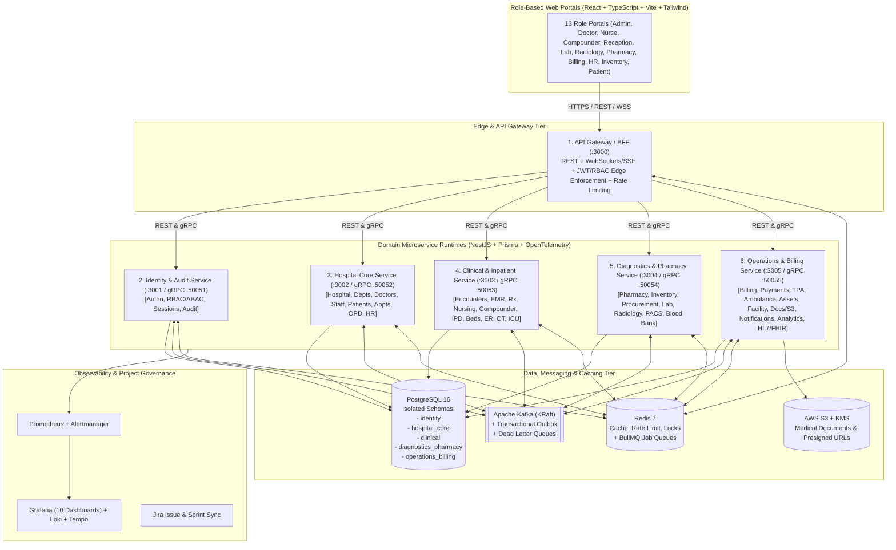

# BLOCK 01 — System Architecture (`SYSTEM_ARCHITECTURE.md`)

## 1. Architectural Vision & Scale Target

The **Hospital Operating Software (HOS)** is engineered for a **500+ bed multispecialty hospital** supporting:
- Multi-building, multi-floor, multi-ward physical topology (with multi-branch tenant readiness via `hospitalId`).
- 38 distinct clinical, diagnostic, pharmacy, operational, financial, and administrative domain capabilities.
- High-concurrency OPD queues, real-time IPD/ICU bed state machines, emergency triage, OT scheduling, laboratory/radiology order lifecycles, and double-entry-grade billing integrity.
- Strict healthcare safety invariants: immutable signed clinical records (addendum-only modifications), transactional outbox event publishing, idempotent consumers, zero cross-service database queries, and zero PHI in logs/metrics/Kafka payloads where synthetic/reference IDs suffice.

---

## 2. Domain-Clustered Microservice Topology (38 Capabilities → 6 Deployable Services)

In accordance with **Block 01 guidelines** (*"Do not create a separate microservice for every trivial feature if that would produce unnecessary operational complexity. Justify service boundaries and group closely related capabilities where appropriate"*), the 38 required domain services are structured as **38 explicit NestJS domain modules** deployed across **6 bounded-context microservice runtimes**, each owning an isolated PostgreSQL schema and dedicated database credentials:

| Deployable Runtime | HTTP Port | gRPC Port | Owned PostgreSQL Schema | Encapsulated Domain Services (from the 38 Required Services) |
|---|---|---|---|---|
| **1. `api-gateway`** | `3000` | — | Stateless (Redis cache/rate-limit) | **[1]** API Gateway / BFF, WebSocket/SSE Real-time Gateway |
| **2. `identity-service`** | `3001` | `50051` | `identity` | **[2]** Identity & Authentication, **[3]** Authorization (RBAC/ABAC), **[36]** Audit Service |
| **3. `hospital-core-service`** | `3002` | `50052` | `hospital_core` | **[4]** Hospital Configuration, **[5]** Employee/Workforce, **[6]** Doctor Management, **[7]** Patient Management, **[8]** Appointment, **[9]** OPD, **[30]** HR & Payroll |
| **4. `clinical-emr-service`** | `3003` | `50053` | `clinical` | **[10]** Encounter, **[11]** Clinical/EMR, **[12]** Prescription, **[13]** Nursing, **[14]** Compounder, **[15]** IPD, **[16]** Bed Management, **[17]** Emergency, **[18]** OT, **[19]** ICU |
| **5. `diagnostics-pharmacy-service`** | `3004` | `50054` | `diagnostics_pharmacy` | **[20]** Pharmacy, **[21]** Inventory, **[22]** Procurement, **[23]** Laboratory, **[24]** Radiology, **[25]** PACS Integration, **[29]** Blood Bank |
| **6. `operations-billing-service`** | `3005` | `50055` | `operations_billing` | **[26]** Billing, **[27]** Payment, **[28]** Insurance/TPA, **[31]** Ambulance, **[32]** Asset Management, **[33]** Facility Management, **[34]** Notification, **[35]** Document (S3), **[37]** Reporting & Analytics, **[38]** Integration Service |

---

## 3. High-Level System Architecture Diagram

---

## 4. Communication Patterns

1. **Frontend-to-Gateway (REST + WebSockets/SSE):**
   - All browser traffic enters through `api-gateway` (`:3000/api/v1/*`) with Bearer JWT authentication, correlation ID injection (`X-Correlation-Id`), request validation, and Redis-backed rate limiting.
   - Real-time updates (OPD queue tokens, bed allocation board, critical lab alerts) stream over WebSockets (`/ws`) backed by Kafka consumer events.
2. **Synchronous Service-to-Service (gRPC / Internal REST with S2S Token):**
   - Used strictly where immediate consistency validation is mandatory before committing a transaction:
     - Token introspection / permission evaluation (`identity-service` gRPC).
     - Verifying Patient MRN & active Doctor registration before creating an Encounter (`hospital-core-service` gRPC).
3. **Asynchronous Event-Driven Architecture (Apache Kafka + Transactional Outbox):**
   - State-changing business operations write both the domain entity and an `OutboxEvent` record in the **same PostgreSQL ACID transaction**.
   - An Outbox Relay publisher publishes events to Kafka topics (`hospital.patient.registered`, `hospital.encounter.created`, `hospital.prescription.created`, etc.) with `eventId`, `correlationId`, and partition key (`patientId` or `hospitalId`).
   - Downstream consumers check their `ProcessedEvent` table for `eventId` before executing side effects, guaranteeing **at-least-once delivery with effectively-once processing**.
4. **Background Jobs (Redis + BullMQ):**
   - Scheduled appointment reminders, PDF invoice/report rendering, S3 lifecycle verification, and external SMS/Email dispatch run via BullMQ queues with exponential backoff and failed-job retention.

---

## 5. Healthcare Safety & Clinical Record Integrity

- **Signed Clinical Records Are Immutable:** Once an Encounter Note, Prescription, Lab Report, or Radiology Report transitions to `SIGNED` / `FINALIZED`, `UPDATE` and `DELETE` operations on clinical content are rejected at the service and database trigger/repository layer. Corrections require an explicit **Addendum** record linked to the parent record with author, timestamp, and reason.
- **No Fabricated Clinical Rules:** Vital sign ranges, drug-allergy alerts, and triage priorities are stored as configurable reference data in the database rather than hardcoded clinical judgments.
- **PHI Minimization in Telemetry & Events:** Kafka events carry resource identifiers (`patientId`, `encounterId`, `orderId`), timestamps, and status transitions rather than raw clinical narratives or unencrypted PII.

